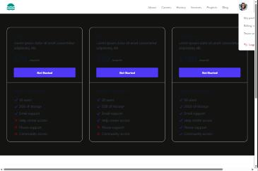

# Tailwind CSS Practice

My hand-coded Tailwind CSS work from my full-stack web development journey. Set up with a real build (not the Play CDN) — `input.css` with `@import "tailwindcss"`, compiled to `output.css` using the Tailwind CLI watcher.

## Pages

### Login form — `index.html`
A centered dark login card built fully with utility classes: flexbox centering, spacing, rounded inputs, and focus rings.


### Layout demo — `layout.html`
Flexbox layout practice: boxes arranged in a row using sizing, spacing and gap utilities.


### Responsive pricing page — `responsive.html`
A responsive pricing section: a navbar plus three pricing cards with feature lists, built mobile-first.



## What I learned
- Real Tailwind build with the CLI watcher (`npx tailwindcss -i ./input.css -o ./output.css --watch`), not the CDN.
- Utility-first thinking: spacing, sizing, colors (shades 50 to 950), typography, flexbox and grid, all as short utility classes.
- Mobile-first responsive design: unprefixed utilities apply everywhere, `sm:` / `md:` prefixes layer styles on larger screens. The reusable pattern `grid grid-cols-1 sm:grid-cols-12` plus `sm:col-span-*` gives full width on mobile and partial columns on desktop.
- `gap` goes on the flex or grid container, not the items, and an empty div needs an explicit height to be visible.

## Run it
```bash
npm install
npx tailwindcss -i ./input.css -o ./output.css --watch
```
Then open any HTML file with Live Server.

## About
Computer Science student learning full-stack web development. Everything here is hand-coded to build genuine understanding.
